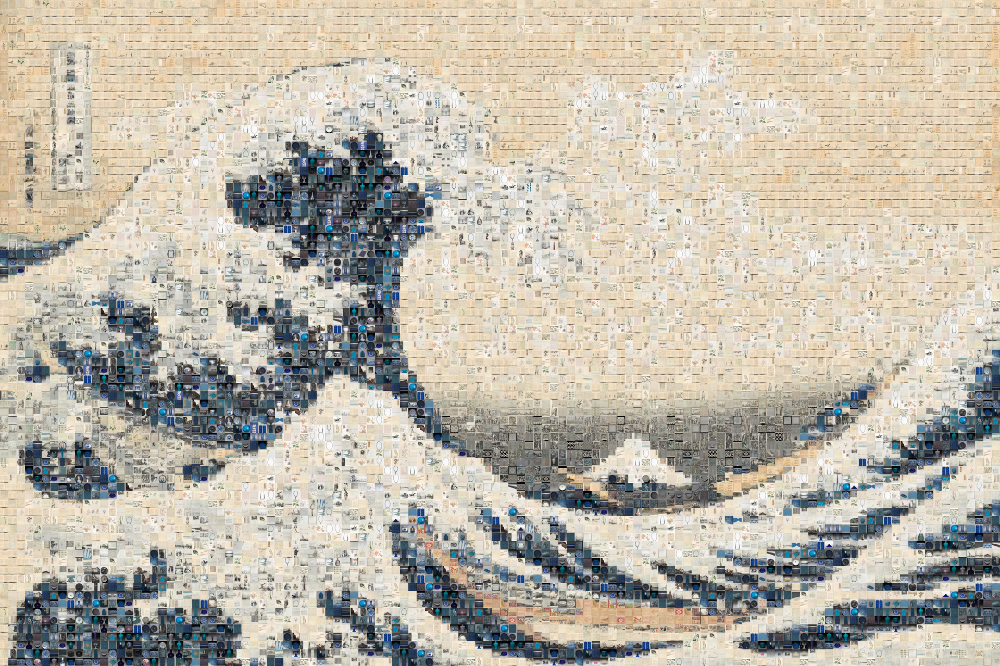
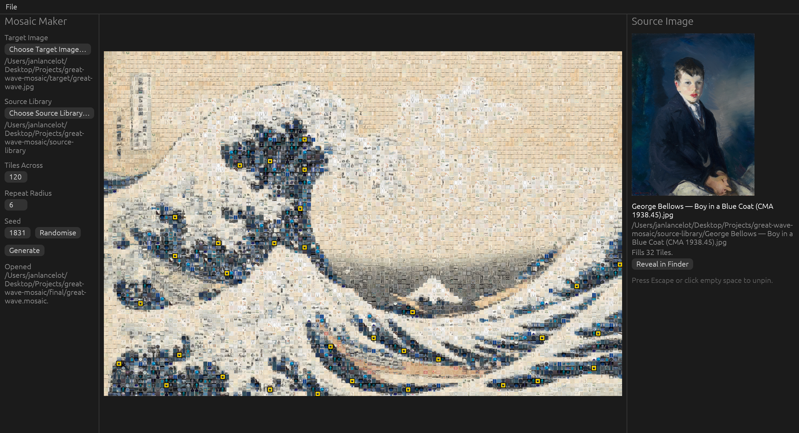
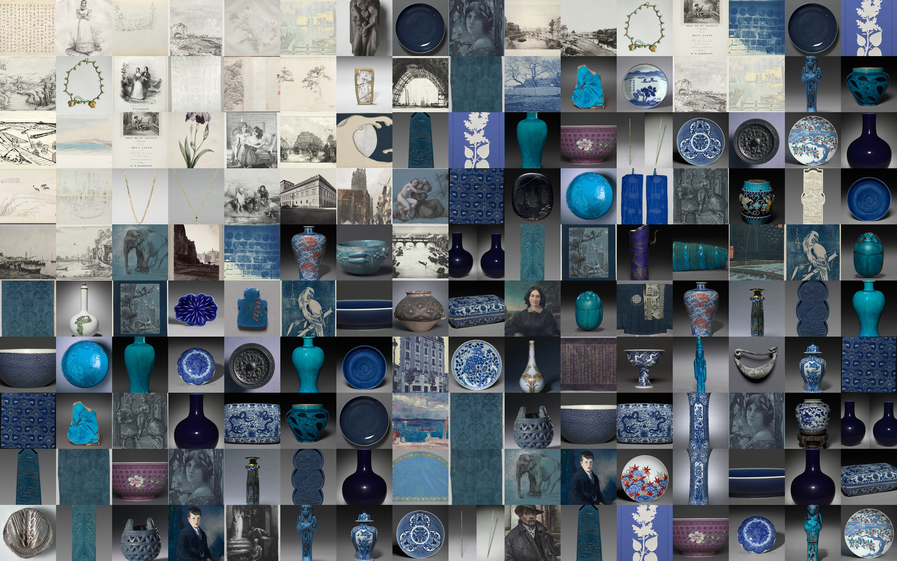

# Mosaic Maker

Rebuild a picture out of thousands of others, then click any square to see which one it is.



That's Hokusai's *Great Wave*, made of a museum: 1,148 public-domain artworks from the Cleveland Museum of Art, each one cropped to a square and never recolored. Click any square in the app and it tells you which artwork sits there.



Each square is a **Tile**. Click one and the panel on the right shows the artwork that fills it at full size, with its file name and where it lives on your computer. Every other Tile that artwork fills lights up, so you can see everywhere it landed.



Every Tile is someone's work, so Mosaic Maker never recolors one to fit. Most mosaic makers tint each picture toward the color its spot needs, which makes a closer copy and misrepresents the art. Here the likeness comes from choosing the right picture, not from changing it.

Give your pictures [Credits](#credits) and a click tells you who made each one, too.

## Download

Get the latest version for macOS, Windows or Linux from the [Releases page](https://github.com/JanLancelot/mosaic-maker/releases/latest). To build it yourself instead, see [Building from source](#building-from-source).

## Make a Mosaic

1. **Choose Target Image…**: the picture to recreate.
2. **Choose Source Library…**: a folder of pictures to build it from. Pictures in its subfolders count too; hidden files don't.
3. Adjust the settings, or leave them as they are:
   - **Tiles Across**: how many Tiles wide the Mosaic is, from 1 to 300. More Tiles, finer detail.
   - **Repeat Radius**: how many Tiles apart the same picture has to be before it can appear again, from 0 to 20.
   - **Seed**: which of many equally good Mosaics you get. Don't like this one? Press **Randomise** and generate again. Keep the Seed, and the same picture, folder and settings always give the same Mosaic.
4. Press **Generate**.

## Save and share

**File → Save…** writes the Mosaic to a single `.mosaic` file. It carries a small **Thumbnail** of every picture in it, so it opens without the folder it was built from: for you next month after you've reorganized your pictures, or for a friend who never had them. Send it to someone and the credit goes with it: they can click any Tile and see which artwork sits there.

When a picture's file has been moved, renamed, edited or deleted since the build, or was never on this computer, the panel shows its Thumbnail instead of the full-size **Original**.

## Credits

Every Tile is someone's work, so each picture can have a **Credit**: its artist, title, date, collection and link. Credits come from a **Credits File**, a `credits.csv` you write in a spreadsheet or generate from a script:

- the one at the root of the Source Library credits its pictures;
- the one beside the Target Image credits the Target Image. When the Target Image sits at the root of the Source Library, one file credits both.

The first row names the columns: `path`, then any of `artist`, `title`, `date`, `collection` and `link`, in any order.

```csv
path,artist,title,date,collection,link
etchings/appian-san-remo.jpg,"Adolphe Appian (French, 1818–1898)",The Port at San Remo,1878,CMA 2001.103,https://clevelandart.org/art/2001.103
bookplates/truesdell.jpg,,Bookplate: Amy Ivers Truesdell,1901,CMA 1920.1413,https://clevelandart.org/art/1920.1413
```

`path` is the picture's file relative to the Credits File's folder, written with `/` on every platform. Every other field is free text, kept as written, and an empty cell means unknown. A picture without a row simply has no Credit, and columns the app doesn't know are ignored, so you can keep your own notes beside them. A Credits File that can't be read, a path that names no file, or a path listed twice shows up with the build's other warnings, and the build carries on.

Credits are fixed when a Mosaic is built: each is attached to its picture and saved in the `.mosaic` file, so the Mosaic keeps its Credits even after the Credits File changes or disappears. After editing a Credits File, press **Generate** again. Credits never change which picture fills which Tile.

Click a Tile and the panel shows its picture's Credit under it, with the title linked to the artwork's web page.

**File → Save Credits List…** writes a Markdown **Credits List**: the Target Image's Credit, then a table of every picture in the Mosaic with its Credit and how many Tiles it fills, sorted by artist, then any pictures still without a Credit, so you can see what's left. Write your own introduction around it and publish it: this project's [CREDITS.md](CREDITS.md) is one.

## Print it

A poster is where "every Tile is someone's work" stops being a claim: walk up to the wall and there are paintings in it.

**File → Export PNG…** asks for a **Tile Size**: how many pixels wide to draw each Tile, from 1 to 512. Tiles are drawn from their Originals wherever those can still be found, which is what keeps a print sharp up close, and from their Thumbnails where they can't.

For a print at 300 dpi:

```
Tile Size = print width in inches × 300 ÷ Tiles Across
```

A landscape A2 poster is 23.4 inches wide, so a Mosaic 100 Tiles across needs a Tile Size of about 70 px.

## Building from source

You need [Rust](https://rustup.rs) 1.85 or newer.

```sh
git clone https://github.com/JanLancelot/mosaic-maker.git
cd mosaic-maker
cargo run --release -p mosaic-app
```

## Working on Mosaic Maker

Enable the project's git hooks once per clone:

```sh
git config core.hooksPath .githooks
```

Before each commit they run `cargo fmt --check`, Clippy and a glossary check, and they require commit messages in the [Conventional Commits](https://www.conventionalcommits.org) form `type: summary`. Changes reach `main` through a pull request from a branch named the same way, such as `feat/short-summary`. CI runs the same checks, plus `cargo test`.

The words in the window are the words in the code. [GLOSSARY.md](GLOSSARY.md) defines every term (a Tile is a position, never the picture that fills it) and lists the words to avoid, which the hooks reject. Read it before the code.

The decisions that look strange are written down in [docs/adr/](docs/adr/): why the app uses egui rather than a web UI, why Tiles are never tinted, and why a picture is identified by its contents rather than its path.

## Artwork in this README

The Great Wave Mosaic in this README is built entirely from public-domain artworks: Hokusai's print is from The Metropolitan Museum of Art, and every Tile is filled from the Cleveland Museum of Art's open-access collection. Every one of them is listed, with its title and artist, in [CREDITS.md](CREDITS.md), a Credits List saved by the app.

## License

Licensed under either of the [Apache License, Version 2.0](LICENSE-APACHE) or the [MIT license](LICENSE-MIT), at your option.
